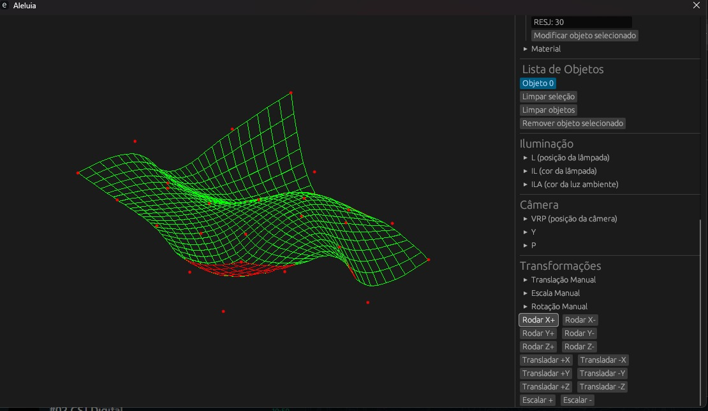
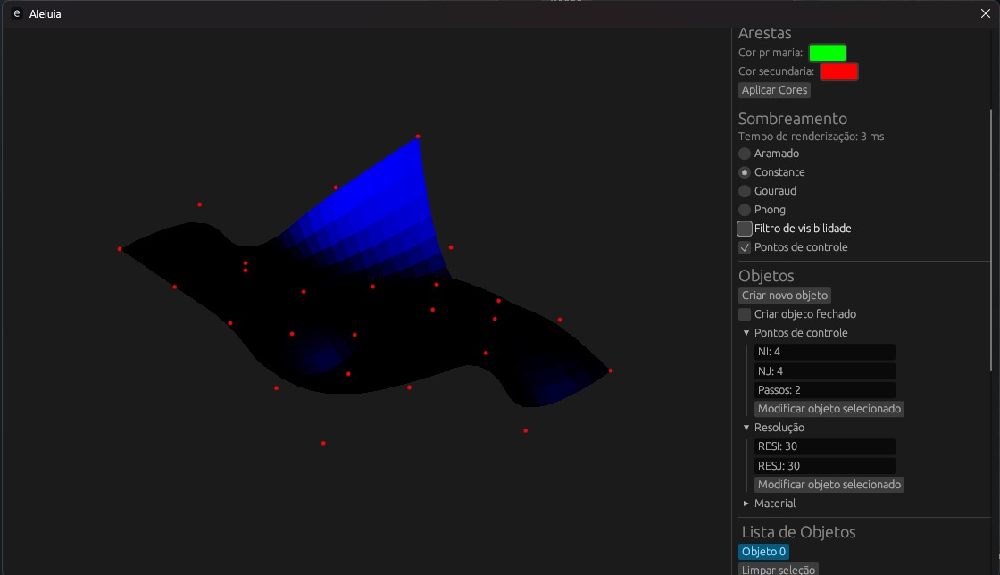
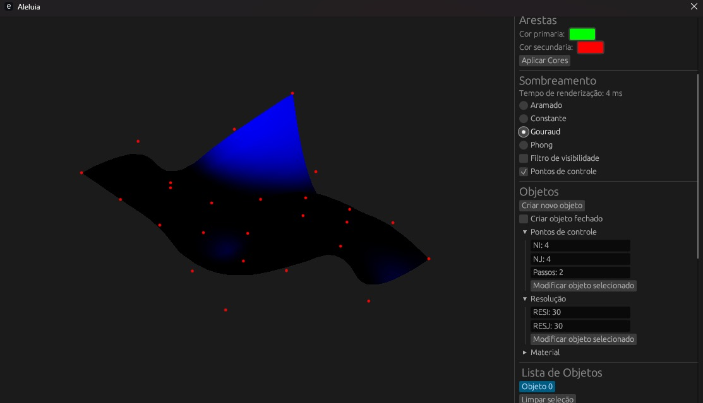
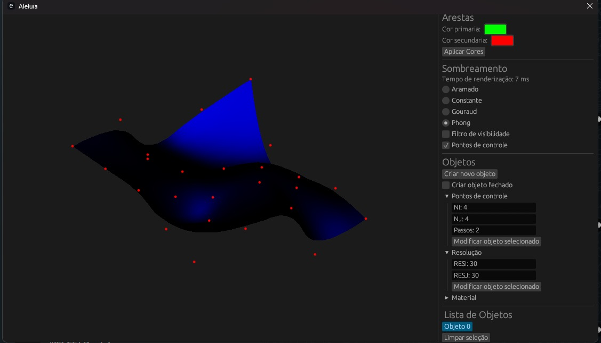

# Bezier Spline
## Curvas de Bezier
>Colaboradores: [Heloisa Alves](https://github.com/Helogizzy), [Luiz Becher](https://github.com/lbecher) e [Matheus Jacinto](https://github.com/MatheusLFJacinto)

## Sobre
As curvas de Bézier são funções matemáticas muito utilizadas em gráficos computacionais, design e modelagem geométrica para representar curvas suaves e facilmente controláveis. Elas foram desenvolvidas na década de 1960 por Pierre Bézier, engenheiro da Renault, e desde então se tornaram fundamentais em áreas como animação, tipografia digital, softwares de design e interfaces gráficas.

O presente trabalho aborda a representação de curvas de Bézier associada a três métodos de sombreamento distintos: Constante, Gouraud e Phong. Inicialmente, uma malha é modelada, exibindo a parte visível em verde e a parte não visível em vermelho. Adicionalmente, os pontos de controle da curva podem ser movimentados, permitindo ajustes interativos na forma da curva diretamente na tela. A imagem abaixo exemplifica as características mencionadas:

## Sombreamento

### Constante
Nesse método, a iluminação é calculada apenas uma vez por face, usando a normal da superfície. O resultado é uma cor uniforme em todo o polígono, o que deixa a aparência facetada. É simples e rápido, mas pouco realista.

### Gouraud
O sombreamento de Gouraud calcula a iluminação em cada vértice e depois interpola os valores para o interior da face. Isso cria transições suaves entre polígonos, mas pode perder detalhes de brilho especular se ele não coincidir com um vértice.

### Phong
O modelo de Phong interpola as normais entre os vértices e calcula a iluminação em cada pixel. Esse processo resulta em superfícies muito mais realistas, com reflexos e brilhos bem definidos, embora seja mais custoso computacionalmente.

